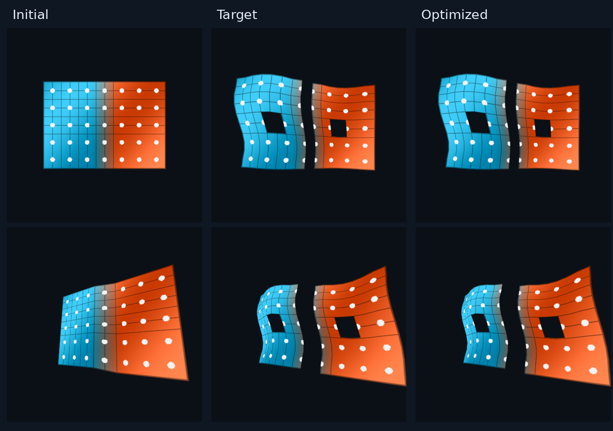
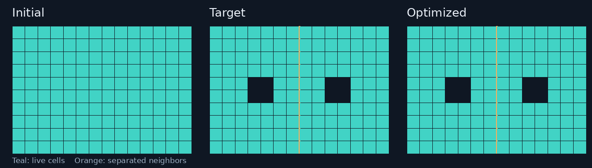
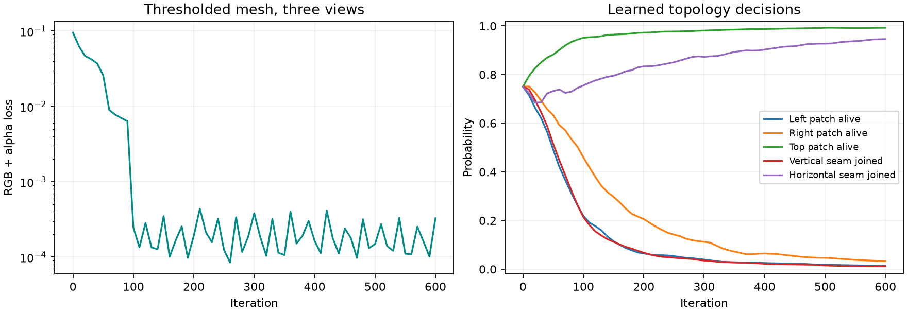

Learning pixel-grid geometry and topology
=========================================

Moving vertices changes the shape of an existing mesh. Opening a hole or
separating two neighboring cells also changes which triangles and shared
vertices exist. This example learns both kinds of change from rendered images:
:func:`drtk.pixel_grid_mesh` builds each hard mesh, and
:func:`drtk.bernoulli_render_loss` supplies a stochastic gradient for its
topology decisions.

   The initial sheet is connected and has no holes. Optimization opens two
   holes, separates the vertical depth seam, and fits the deformation.
   The second row shows a viewpoint not used for training.

The scene
---------

The source is a 10 by 14 grid with one depth step. Each cell starts as a quad
with corners on source-pixel boundaries. The fixed texture mixes broad color
variation with a grid and dots, making deformation visible in both smooth
regions and fine detail.

For a small, readable example, five logits control groups of cells or edges:
three candidate patches can be present or absent, and two candidate seams can
be joined or separated. The target removes two patches and opens the vertical
seam; it keeps the third patch and the horizontal seam connected.
The mesh builder itself accepts a decision for every cell and neighbor pair.
Grouping decisions here keeps the stochastic optimization small enough to
inspect directly.

Geometry uses eighteen coefficients: six fixed spatial basis functions for
each of X, Y, and Z displacement. The depth map, camera intrinsics, texture,
diagonals, and feather width stay fixed. All geometry coefficients and topology
logits train together from the first iteration.

   Source-cell maps distinguish actual holes and cuts from a shape that only
   looks similar after deforming its triangles.

From decisions to a mesh
------------------------

A positive join decision means that neighboring live cells share their edge.
A cut lets their corner proposals separate. At each lattice corner, the
builder averages proposals only within a locally connected fan. A missing
cell contributes no triangles. See :doc:`../api_reference/pixel_grid_topology`
for crack tips, isolated-cut cleanup, and the camera convention.

The example expands the five sampled decisions into the builder's per-cell
and per-edge tensors:

.. literalinclude:: ../_static/pixel_grid_mesh_demo.py
   :language: python
   :pyobject: Scene.topology

The native builder returns a fixed tuple. Its vertices already include
displacement; ``vt0`` holds original texture coordinates, while ``vt1``
projects the displaced geometry back into the source image. This example
uses ``vt0`` to keep the original texture attached to the material:

.. literalinclude:: ../_static/pixel_grid_mesh_demo.py
   :language: python
   :pyobject: Scene.mesh

The fixed feather width is 0.08 source pixels. Generated strips fade from
opacity one at the mesh boundary to zero at their outer edge. Width is not
optimized in this example, but it can receive continuous gradients.

Rendering and supervision
-------------------------

The builder returns source-camera 3D positions. The example transforms these
positions into each target camera and projects them to pixel XY plus camera
Z before calling :func:`drtk.render_transparent`. It uses three training views
and a fixed RGB texture with ``rgb_activation="identity"``.

For each view, the loss is

.. math::

   \mathcal L =
   \operatorname{MSE}(C, C^\star)
   + 0.25\,\operatorname{MSE}(A, A^\star),

where :math:`C` is premultiplied color and :math:`A` is accumulated alpha.
The target mesh only generates these supervision images. Its vertex positions,
alive labels, and join labels are not losses supplied to the optimizer.
The dark background in the figures is added for display after rendering.
The renderer also returns depth; this example discards it and keeps the
RGB/alpha objective shown above. See :doc:`../api_reference/transparent_render`
for the expected, accumulated, foreground-mean, and median depth modes.

.. literalinclude:: ../_static/pixel_grid_mesh_demo.py
   :language: python
   :pyobject: Scene.loss

Learning hard decisions
-----------------------

Let :math:`p=\sigma(\eta)` be the probabilities represented by the logits.
The objective averages the loss of hard sampled meshes:

.. math::

   F(\eta,x)=\mathbb E_{z\sim\operatorname{Bernoulli}(p)}
   \left[\mathcal L\!\left(R(M(z,x))\right)\right].

Here :math:`x` contains continuous geometry parameters. Ordinary backward
propagates through those parameters for each sampled mesh. Boolean masks and
triangle indices themselves do not acquire derivatives.

The ARM estimator uses a shared uniform sample to form two correlated
topologies. :func:`drtk.bernoulli_render_loss` evaluates their losses and adds
the corresponding logit-gradient estimator. The returned forward value is the
mean sampled loss. It preserves the ordinary geometry gradients from both
evaluations.

.. code-block:: python

   def evaluate(bits):
       return scene.loss(bits, coefficients, view_index)

   optimizer.zero_grad()
   loss = bernoulli_render_loss(
       logits, evaluate, pairs=4, generator=generator
   )
   loss.backward()
   optimizer.step()

Four pairs require eight renders per step. The training view is selected
before evaluating the pair, so both samples use the same view and target.
Average the losses of sampled images; averaging images before taking the loss
would optimize a different objective.

:func:`drtk.bernoulli_topology_samples` exposes the two hard samples and their
shared random numbers when a custom estimator is needed. The example above
uses the complete loss helper directly.

Watching the fit
----------------

.. raw:: html

   <video controls playsinline preload="metadata"
          poster="../_static/pixel_grid_mesh_demo_poster.png"
          aria-label="Optimization of pixel-grid geometry and topology"
          style="width:100%; height:auto;">
     <source src="../_static/pixel_grid_mesh_demo.mp4" type="video/mp4">
     
<a href="../_static/pixel_grid_mesh_demo.mp4">Download the optimization video.</a>

   </video>

The video shows saved optimizer states, with the current probabilities and
the hard mesh obtained by thresholding them at 0.5. The final camera motion
changes only the viewpoint. No parameters are interpolated between recorded
states.

   The diagnostic loss evaluates the thresholded mesh across all three
   training views. Training instead samples topology and estimates expected
   loss. The two quantities need not decrease monotonically together.

The saved run recovers the five intended hard decisions and substantially
reduces rendered error, with a small residual geometric mismatch. This is a
controlled example with grouped decisions and a smooth deformation basis;
it does not establish convergence for unrestricted per-cell topology and
geometry. More decisions can increase estimator variance, and geometry can
sometimes compensate for an incorrect topology.

Run the example
---------------

Download :download:`pixel_grid_mesh_demo.py <../_static/pixel_grid_mesh_demo.py>`.
It uses a CUDA-enabled DRTK installation, PyTorch, Pillow, Matplotlib, and
FFmpeg for the video.

.. code-block:: console

   python pixel_grid_mesh_demo.py --steps 600 --pairs 4 --output pixel_grid_demo

The output directory contains the checkpoint, recorded probabilities and
losses, comparison figures, and an H.264 MP4. To regenerate only the media
from the saved states:

.. code-block:: console

   python pixel_grid_mesh_demo.py --render-only --output pixel_grid_demo

API signatures and complete argument contracts are in
:doc:`../api_reference/pixel_grid_mesh`. The
:doc:`../api_reference/pixel_grid_topology` guide develops the geometry and
stochastic-gradient model in more detail.
