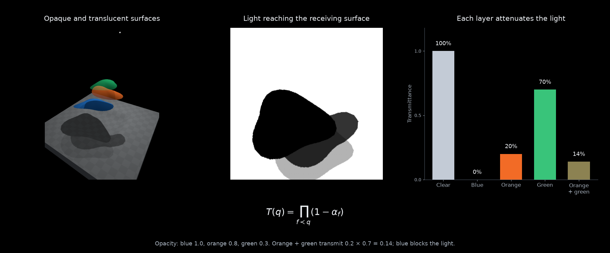

Differentiable visibility
=========================

Recover the shape and opacity of three surfaces from the shadows
they cast. Three fixed lights illuminate a recessed platform, and a loss on
the shadows adjusts the surfaces above it. The blue object is opaque, the
orange object is 80% opaque, and the green object is 30% opaque.

A light can be treated as a camera. Project a point on the receiver
into that camera and evaluate how much light reaches it through the intervening
surfaces. :func:`drtk.source_transmittance` returns these values in the receiver's
query order, so the shadow lives in its original surface grid. Moving the
objects changes the shadow while the receiving points stay fixed.

.. raw:: html

   <video controls playsinline preload="metadata" style="width:100%;height:auto"
     poster="../_static/source_features_demo_poster.png">
     <source src="../_static/source_features_demo.mp4" type="video/mp4">
     Your browser does not support HTML video.
   </video>

Each column shows the scene illuminated by a different light, with the
target and fitted transmittance maps below it. The maps are expressed in
receiver UV coordinates, so the loss compares lighting at the same surface
points throughout the optimization.
The objects' outlines, positions, heights, and material opacities are optimized
together. The curve compares the default gradients with a control that
disables visibility-boundary gradients.

Shadows through transparent surfaces
------------------------------------

For opaque objects, a point is either illuminated or blocked. A translucent
surface with opacity :math:`\alpha` passes a fraction :math:`1-\alpha` of
the light. With several layers, their transmittances multiply:

.. math::

   T_k(q)=\prod_{f\prec q}\left(1-\alpha_f(p_k(q))\right),
   \qquad p_k(q)=\pi_k(X(q)).

Here :math:`X(q)` is a point on the receiving surface and :math:`\pi_k`
projects it into light :math:`k`. The product contains fragments preceding
the receiver in the renderer's stable triangle-depth order. The receiver's
own opacity is excluded.

   Transmittance ranges from zero behind the opaque object to 0.7 behind
   the faint green surface. The orange-green overlap transmits
   :math:`0.2\times0.7=0.14` of the light.

For unoccluded direct illumination :math:`E_k(q)`, the shadowed illumination is

.. math::

   I(q)=\sum_k T_k(q)E_k(q).

The example compares each light separately and uses unit unoccluded
illumination, so its shadow intensity is simply transmittance. Distance
falloff, receiver orientation, and light intensity can be included in
:math:`E_k`. The scene views use Lambertian diffuse lighting, inverse-square falloff,
and a small ambient term. These display effects do not enter the loss.
This model describes attenuation by thin surfaces; refraction and multiple
scattering require a different light-transport model.

Evaluating shadows on the receiver
----------------------------------

Create query points on the receiver using face IDs and 3D barycentric
coordinates. Include both the shadow-casting objects and the receiver in the
mesh. Transform its vertices into each light's camera coordinates, with pixel
XY and positive camera Z:

.. code-block:: python

   vertices = make_mesh(shape_parameters)
   v_light = project_to_lights(vertices)
   indices, weights, _, _ = drtk.source_transmittance(
       v_light, faces, receiver_faces, receiver_barycentrics,
       light_height, light_width,
       vertex_opacity=material_opacity,
   )
   transmittance = weights.sum(-1).reshape(num_lights, H0, W0)

The operation evaluates transmittance at the four bilinear texel taps of
each query. Its weights are :math:`w_{qj}=b_{qj}T_{qj}`, where
:math:`b_{qj}` is the bilinear coefficient. Summing them gives filtered
transmittance. Taps outside the light's image or the receiving surface
contribute zero; size the light frustum to cover the receiving region.
The example checks that every query returns one when the objects are
fully transparent.

The output belongs to the receiving surface, rather than the light's image
plane. The query face IDs and barycentrics provide this correspondence;
reshape using the original query-grid dimensions :math:`H_0\times W_0`.
For a deforming receiver, keep the queries attached to its triangles to
preserve their UV correspondence.

A projector can supply a spatially varying image instead of uniform light:

.. code-block:: python

   illumination, confidence = drtk.sample_with_transmittance(
       light_image, indices, weights
   )
   illumination = illumination.reshape(num_lights, channels, H0, W0)

``illumination`` already includes attenuation. The same indices and weights
can be applied to several image or feature channels on the light's grid.

Fitting shape and opacity
-------------------------

The three target shadow maps are generated from curved surfaces with
different opacities. Each surface has a radial outline with seven Fourier coefficients,
a 3D position, and one material opacity. Its tilt and bowing remain fixed. The fit starts
from displaced, distorted outlines with different sizes. The initial opacities
are 0.3, 0.5, and 1.0 for blue, orange, and green: the object that should be
opaque starts mostly transparent, while the faintest target starts opaque.

Let :math:`\theta` contain the geometry parameters and let
:math:`\alpha\in[0,1]` contain their opacities. The objective is

.. math::

   L(\theta,\alpha)=\frac{1}{K H_0 W_0}
   \sum_{k,q}\left(c_k(q;\theta,\alpha)-c_k^*(q)\right)^2,
   \qquad c_k(q)=\sum_j w_{kqj}.

Only the target shadows enter this loss. The 3D views show what is being
optimized but supply no image or geometry supervision.

.. code-block:: python

   optimizer.zero_grad()
   transmittance = evaluate_shadows(shape, opacity)
   loss = (transmittance - target_shadows).square().mean()
   loss.backward()
   optimizer.step()
   with torch.no_grad():
       opacity.clamp_(0, 1)

For fixed coverage, transmittance is differentiable with respect to opacity:

.. math::

   \frac{\partial T}{\partial\alpha_i}
   =-\prod_{\substack{f\prec q\\f\ne i}}(1-\alpha_f).

Moving an object also moves its shadow boundary. That coverage change needs
the boundary-motion estimator, enabled by default. Smooth derivatives alone
adjust the opacities in this scene but leave the geometry unchanged.

The fit uses projected Adam steps: after each update, opacities are clamped
to the valid interval. This permits an exactly opaque surface at
:math:`\alpha=1`, as well as partially transmitting surfaces. With boundary
gradients, 300 steps recover opacities close to 1.0, 0.8, and 0.3 and align all
three shadow maps. The smooth-gradient control adjusts opacity but retains
the initial shape and position. The finite shadow grid limits geometric precision: matching its samples does not imply a unique reconstruction of
an arbitrary object. Multiple lights constrain more shape directions than
a single shadow.

From lights to camera features
-------------------------------

Replace the light with a source camera and its illumination image with an
image-feature map. The same operation then returns attenuated observations
at the original surface points:

.. code-block:: python

   sampled, confidence = drtk.sample_with_transmittance(
       source_features, indices, weights
   )
   sampled = sampled.reshape(num_views, num_channels, H0, W0)
   confidence = confidence.reshape(num_views, 1, H0, W0)
   prediction = model(original_features, sampled, confidence)

Confidence distinguishes an attenuated observation from an observed feature
whose value is zero. Features already mixed by transparency or a feature
extractor remain mixed; transmittance describes access to the observation.

Run the example
---------------

Download :download:`source_features_demo.py <../_static/source_features_demo.py>`.
It requires a CUDA-enabled DRTK installation, Matplotlib, and FFmpeg.

.. code-block:: bash

   python source_features_demo.py --output ./source_features_demo

The output contains a 1920×1600 optimization video showing every iteration,
a shadow illustration,
snapshots, measurements, and saved geometry and UV transmittance fields.
Scene views render at 768×1024, light views at 1024×1024, and receiver maps at
512×512. See
:doc:`../api_reference/source_features` for tensor shapes, camera conventions,
and gradient behavior.
