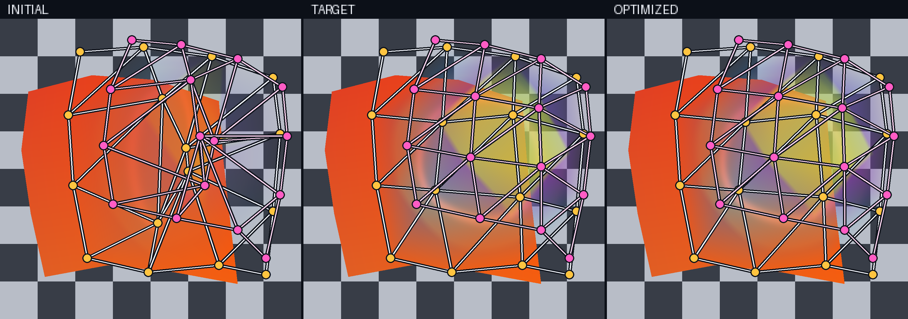
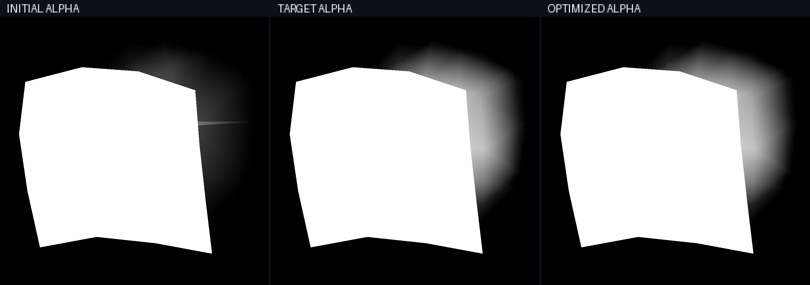

Optimizing transparent mesh layers over opaque geometry
========================================================

Transparent surfaces require more than selecting the nearest triangle at each
pixel. Every covered fragment may contribute to the image, and its contribution
depends on both its appearance and the transmittance left by fragments in front
of it. :func:`drtk.render_transparent` evaluates fragments in depth order
and returns composited color, foreground alpha, and depth while retaining
gradients to mesh and appearance inputs. This example uses color and alpha;
see :doc:`the API reference <../api_reference/transparent_render>` for the
selectable depth modes.

This example fits two overlapping semitransparent mesh layers above a fixed
opaque rear mesh. Each of the three layers is a 4 x 4 patch with sixteen
vertices and eighteen triangles. Their topology, boundary vertices, depth, UV
coordinates, and texture remain fixed. The rear opacity is fixed at one.
Optimization changes the projected positions of eight interior vertices, four
in each transparent layer, and their eight vertex-opacity values. Outer opacity
on both transparent patches remains zero, so the input geometry explicitly
provides smooth transparent boundaries.

Fixed appearance
----------------

The renderer samples the following procedural three-tile atlas. The orange tile
belongs to the opaque rear layer, the blue circle motif belongs to the
transparent middle layer, and the purple and yellow diamond belongs to the
transparent top layer. All texture tiles are opaque; independent interpolated
vertex-opacity fields control material transparency.

Because this atlas stores conventional color and alpha rather than learned raw
parameters, the example selects ``rgb_activation="identity"`` and
``alpha_activation="clamp"``. Learned direct textures default to ReLU RGB and
ReLU-density alpha. Neural appearance models instead shift the ReLU inputs by
0.5 because their final affine outputs are naturally centered near zero.

   Fixed texture input for the opaque rear mesh and two transparent meshes.

Geometry and opacity fitting
----------------------------

The initial middle and top geometry is distorted and both transparent layers
have incorrect opacity. A color-and-alpha reconstruction objective is
differentiated through texture sampling, perspective-correct interpolation,
depth-sorted compositing, and the learned inputs. The optimized result closely
approaches the target without changing topology, opaque rear geometry, or
texture.

   Initial, target, and optimized color. White lines with yellow points show
   the middle mesh; pink lines with magenta points show the top mesh. The
   checkerboard and mesh overlays are visualization aids and do not participate
   in rendering or optimization.

The checkerboard is composited after rendering as
``premultiplied_color + (1 - alpha) * checkerboard``. The opaque rear mesh hides
it, while transparent patch regions that extend beyond the rear mesh reveal it.
Different orange, blue, purple, and yellow mixtures make the depth-sorted
contributions of both transparent layers directly legible. The renderer itself
returns the premultiplied color and accumulated alpha shown below, together
with the selected depth output.

   Accumulated alpha for the same three states. The opaque rear mesh appears
   white; the transparent extensions reveal the optimized support and opacity
   of the middle and top layers.

The example separates quantities that are easy to conflate in transparent
rendering:

* **topology** is the fixed set of triangle indices;
* **geometry** is the learnable projected position of interior vertices;
* **appearance** comes from a fixed RGB or RGBA texture; and
* **material opacity** is fixed at one for the rear mesh and independently
  interpolated from learned vertex values for both transparent meshes.

The renderer accepts arbitrary triangle meshes rather than only regular grids.
Multiple overlapping meshes may share an atlas or use different atlas regions.
For learned appearance, ``render_transparent_mlp`` samples one feature texture.
``render_transparent_mlp_two_textures`` instead samples ``texture0`` at ``uv0``
and ``texture1`` at ``uv1`` before concatenating their features. Both preserve
the same geometry, sorting, and compositing model.

Gradient scope
--------------

Gradients to vertex positions include smooth shading and compositing
derivatives. The native CUDA renderers also enable a silhouette-gradient
estimator by default through ``edge_gradients=True``. It handles visible
coverage boundaries, including nonzero-opacity contours; ordinary shared
tessellation edges and zero-alpha outer boundaries contribute no extra jump.

This example keeps patch boundaries fixed and optimizes interior vertices,
so its fitting signal comes from texture variation and interpolated opacity.
The reference renderers provide smooth/interior derivatives only. Triangle
topology and depth-order changes remain discrete; the
:doc:`pixel-grid tutorial <DRTK_Tutorial_pixel_grid_mesh>` shows how to optimize
sampled connectivity decisions separately.
